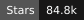
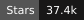

<h1>Agent / LLM Engineer</h1>

独立构建 Agent 系统，也参与成熟开源项目演进。

  
  

  
  &nbsp;·&nbsp; 1 个独立项目&nbsp;&nbsp;·&nbsp;&nbsp;2 个开源项目贡献

---

## 个人项目

### Atlas BI · 企业级电商 NL2SQL 分析平台

  <a href="https://github.com/sun-sh/atlas-bi-nl2sql"><strong>sun-sh/atlas-bi-nl2sql</strong></a>
  &nbsp;
  

**用一句话查经营数据，从问题到 SQL、结果与分析依据。**

独立实现电商数据分析工作台，以 LangGraph 串联 Schema 混合检索、SQL 生成与失败自修复；通过 AST 校验和只读执行控制查询边界，支持流式解读、连续追问与查询追踪。

  <a href="https://github.com/sun-sh/atlas-bi-nl2sql/blob/main/docs/ARCHITECTURE.md">架构设计</a>
  &nbsp;·&nbsp;
  <a href="https://github.com/sun-sh/atlas-bi-nl2sql/blob/main/docs/EVALUATION.md">评测说明</a>
  &nbsp;·&nbsp;
  <a href="https://github.com/sun-sh/atlas-bi-nl2sql">查看项目 →</a>

  

**评测结果：** 项目自建 100 条严格模型用例 **100/100 通过**（2026-10-27，固定数据集与当次模型配置）；要求模型生成 SQL 并完成结果解读。

---

## 开源贡献

### DeerFlow

  <a href="https://github.com/bytedance/deer-flow"><strong>bytedance/deer-flow</strong></a>
  &nbsp;
  
  

针对 Skill 扫描中可执行文件漏检、项目上传取消后资源清理不完整的问题，完善二进制识别与异步清理流程，并补充边界回归测试；修复已合并至主线。

[查看全部已合并 PR →](https://github.com/bytedance/deer-flow/pulls?q=is%3Apr+is%3Amerged+author%3Asun-sh)

### WeKnora

  <a href="https://github.com/Tencent/WeKnora"><strong>Tencent/WeKnora</strong></a>
  &nbsp;
  
  

围绕 Agent 与 RAG 链路，修复流式重试残留、跨知识库 Embedding 维度混用、UTF-8 截断和文件处理问题；补充知识图谱任务 panic 保护与仅手动维护的知识库模式，并优化文档来源定位性能，其中 7 个贡献已进入 v0.9.0 发布版本，相关改动已合并至主线。

> **文档来源定位：约 395ms → 10.4ms** 
> 将重复全文扫描改为单次扫描构建匹配索引。数据来自本地单次微基准测试，输入为 2,000 行、7 列的 CSV 形态数据。

[查看全部已合并 PR →](https://github.com/Tencent/WeKnora/pulls?q=is%3Apr+is%3Amerged+author%3Asun-sh)

---

正在寻找 <strong>Agent 相关工作</strong>，欢迎联系。

<a href="mailto:1665738773@qq.com">1665738773@qq.com</a>

